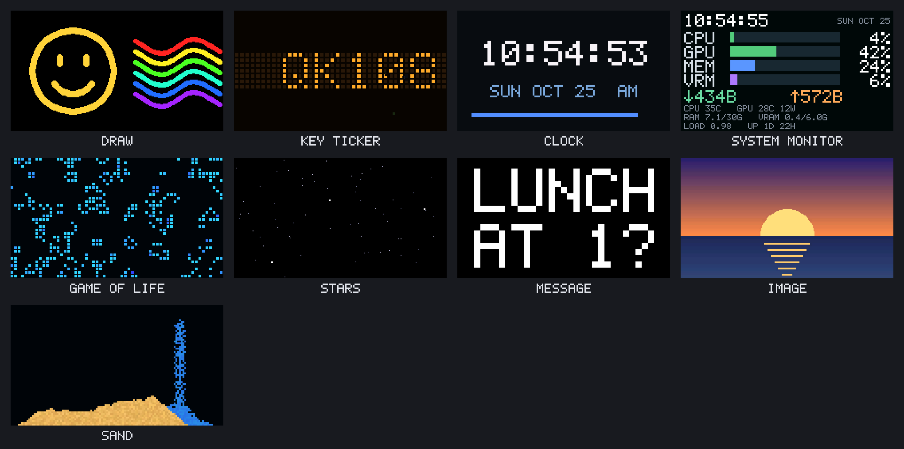

# keyscreen

Turns the screen on a keyboard like the Epomaker QK108 into a small live second monitor, from Linux over USB.



## Hardware

Only the QK108 has been tested. The others share its screen chip (from the keyboard maker RDMCTMZT, USB vendor
`36b0`), going by Epomaker Hub's own device settings and other projects, but nobody has run this code on them.

| Keyboard                                    | USB ID      | Screen  | Status                                                                                                                               |
| ------------------------------------------- | ----------- | ------- | ------------------------------------------------------------------------------------------------------------------------------------ |
| Epomaker QK108                              | `36b0:30af` | 240x136 | **Tested**                                                                                                                           |
| Epomaker RT82                               | `36b0:30a3` | 240x135 | Likely: same screen settings in Epomaker Hub; [rt82display](https://github.com/guysoft/rt82display) drives it with the same commands |
| Epomaker RT98                               | `36b0:30b9` | 240x136 | Likely: same screen settings in Epomaker Hub; its manual uses the same image.rdmctmzt.com uploader                                   |
| Epomaker TH108 V2 PM                        | `36b0:3101` | 320x240 | Possible: same screen settings, but the code assumes 240x136                                                                         |
| Other keyboards that use image.rdmctmzt.com | `36b0:*`    | varies  | Possible: the uploader accepts any device with this screen chip                                                                      |

Not compatible (different screen chips and protocols): Epomaker TH108 Pro, TH99 Pro, G84 Pro, TH80 V2 Pro,
RT100 Pro, RT85, RT75 and Glyph.

Trying another keyboard needs its USB ID in `src/qk108.ts`, `src/keys.ts`, `src/leds.ts` and `70-keyscreen.rules`. If you get one
working, please open an issue.

## Setup (once)

```bash
pnpm install
desktop/install.sh   # asks for sudo once (udev rule), then sets up the service, indicator and GNOME extension
```

The udev rule (`70-keyscreen.rules`) gives the user logged in at the machine:

- the keyboard's vendor channels and the screen controller
- read access to the QK108's key devices and to mice, for the key ticker and Sand mode

No `input` group needed (that one opens every input device to every program you run). Programs you run can still read
what's typed on the QK108, which the key ticker needs. If you added yourself to `input` earlier, you can leave it:
`sudo gpasswd -d $USER input`, then log out and back in.

Bun runs the TypeScript directly; there's no build step. Close Epomaker Hub / image.rdmctmzt.com tabs first: they
grab the screen.

## Use it: `pnpm keyscreen`

```bash
pnpm keyscreen serve               # start the screen server, then open http://localhost:4110
pnpm keyscreen mode stars          # switch mode
pnpm keyscreen text "Lunch at 1?"  # show a message (works without the server too)
pnpm keyscreen image picture.png   # show a picture (works without the server too)
pnpm keyscreen help                # everything else
```

The server streams live content to the screen (~0.6 s delay, no "Downloading" after the first-run setup). The
keyboard shows it on its GIF page: press **Fn + Right Shift** to get there. Modes:

| Mode      | What it shows                                                                                   |
| --------- | ----------------------------------------------------------------------------------------------- |
| `draw`    | what you draw on the page's canvas, in real time                                                |
| `ticker`  | the last letters typed, scrolling like an LED sign, with sparkles on each key press             |
| `clock`   | time with live seconds, and the date                                                            |
| `sysmon`  | CPU, memory, network, CPU graph                                                                 |
| `life`    | Conway's Game of Life, one cell per 4x4 tile                                                    |
| `stars`   | stars rushing toward you                                                                        |
| `message` | a typed message, auto-sized                                                                     |
| `image`   | an uploaded PNG, scaled to fit                                                                  |
| `sand`    | falling sand that pours wherever your mouse is; click to change material, type to blast craters |

### While the computer is locked

When the computer's screen locks or blanks (GNOME), the keyboard goes to sleep: the server stores a short animation
in the screen's flash, the keyboard loops it by itself, and nothing goes over USB until you unlock. Choose it on the
dashboard or with `keyscreen sleep <id>`:

| Sleep animation  | What it shows                                                   |
| ---------------- | --------------------------------------------------------------- |
| `sand` (default) | sand pours down until half the screen is full, then drains away |
| `zzz`            | sleepy Zs drifting up                                           |
| `night`          | a crescent moon and twinkling stars                             |
| `dark`           | a black screen                                                  |
| `custom`         | your own PNG or animated GIF (`keyscreen sleep upload <file>`)  |
| `off`            | don't sleep: keep the live mode                                 |

`keyscreen sleep try` puts it to sleep now so you can see it; `keyscreen sleep wake` wakes it.

Every server action has a CLI command:

| Server                   | CLI                                                                                                 |
| ------------------------ | --------------------------------------------------------------------------------------------------- |
| `GET /api/status`        | `keyscreen status`, `keyscreen modes`                                                               |
| `POST /api/mode`         | `keyscreen mode <id>`                                                                               |
| `POST /api/input`        | `keyscreen key <letters>`, `keyscreen draw x0,y0 x1,y1`, `keyscreen draw clear`, `keyscreen reseed` |
| `POST /text`             | `keyscreen text <message>`                                                                          |
| `POST /image`            | `keyscreen image <file.png>`                                                                        |
| `GET /frame.png`         | `keyscreen frame [out.png]`                                                                         |
| `POST /api/sleep`        | `keyscreen sleep <id>`, `keyscreen sleep try`, `keyscreen sleep wake`                               |
| `POST /api/sleep/upload` | `keyscreen sleep upload <file>`                                                                     |
| `POST /api/shutdown`     | `keyscreen stop`                                                                                    |

Without the server, `text` and `image` write a still picture straight to the keyboard, and it stays there after the
command exits. These commands talk to the keyboard directly, so stop the server first:

| Command | What it does                                                  |
| ------- | ------------------------------------------------------------- |
| `check` | is the screen chip responding?                                |
| `info`  | screen size                                                   |
| `time`  | sync the screen's clock                                       |
| `setup` | set up the flash layout (the screen shows "Downloading" once) |
| `blank` | show a blank screen                                           |

`leds` sets the lock-light icons and works anytime.

Other notes:

- `keyscreen serve --fake --port 4111` runs the server against a simulated screen, without the keyboard.
- The key ticker reads every key typed on the QK108 through the udev rule. If it can't (rule not installed), it uses keys
  typed into its page.
- Only one program can drive the screen at a time.
- The server remembers the selected mode, message, picture and sleep animation (in `state/`) and comes back with them
  after a restart.
- If the screen chip freezes (it shows noise and stops responding), the dashboard and the top-bar icon say so. Power-cycle
  the keyboard: unplug USB, switch it off for 10 s, then reconnect. The server picks up again by itself.

## Start at login, with a top-bar icon

```bash
desktop/install.sh                                       # install (desktop/install.sh --remove to undo)
gnome-extensions enable ubuntu-appindicators@ubuntu.com  # once, if top-bar indicators are off
```

This runs the server as a systemd user service whenever you log in (`systemctl --user status keyscreen`,
`journalctl --user -u keyscreen`) and adds a keyboard icon to the top bar. Click it to open the dashboard (it starts the
server first if it's stopped). Right-click for Start/Stop server. The dashboard's **Stop server** button and
`keyscreen stop` stop it cleanly, and it stays stopped until started again.

To start it at boot before anyone logs in, also run `loginctl enable-linger`.

`install.sh` also installs `keyscreen-pointer`, a tiny GNOME Shell extension (`desktop/gnome-extension/`) that tells
the server where the mouse pointer is, since Wayland doesn't let other programs ask. Sand mode uses it to pour exactly
under the pointer; without it, the position is estimated from the mouse's movement and drifts near the edges. GNOME
loads a newly installed extension after you log out and back in.

## Layout

| Path                            | What's in it                                                                                                  |
| ------------------------------- | ------------------------------------------------------------------------------------------------------------- |
| `src/`                          | the keyboard server and `keyscreen` CLI                                                                       |
| `src/qk108.ts`, `src/hidraw.ts` | USB protocol                                                                                                  |
| `src/live.ts`                   | live streaming                                                                                                |
| `src/service.ts`                | owns the screen and reconnects                                                                                |
| `src/server.ts`                 | HTTP/WebSocket server                                                                                         |
| `src/ui/`                       | the dashboard: React (`app.tsx`, `panels.tsx`, `sleep.tsx`) and `style.css`, bundled by Bun from `index.html` |
| `src/modes.ts`                  | the modes                                                                                                     |
| `src/cli.ts`                    | the CLI                                                                                                       |
| `desktop/`                      | startup service and top-bar indicator                                                                         |
| `lab/`                          | test lab: on-device experiments and the dashboard for running them                                            |
| `state/`                        | runtime state (the flash layout)                                                                              |
| `PROTOCOL.md`                   | the screen's USB API and behavior                                                                             |
| `LOG.md`                        | how we got there, including failed experiments                                                                |

## How the live display works

The screen has no live-pixel command. It can only play QGIF images from its flash, but it reads them frame by frame
while playing. So `src/live.ts` streams into one growing QGIF in a "stream area" at the start of flash, writing each
frame just ahead of playback. When that area fills up:

1. Playback switches to a short stream in a "parking" block.
2. The stream area is erased, without the "Downloading" screen.
3. A fresh stream starts at the beginning.

Erases can only start at block 0, which is why the recycled area sits at the start. Flash layout (`src/layout.ts`):
48 managed blocks, then stored WAIT, DONE and BLANK frames.

## Test lab: `pnpm lab`

```bash
pnpm lab                         # dashboard on http://localhost:4108: run a test, watch the keyboard, report what you saw
bun lab/lab.ts list              # list test cases
bun lab/lab.ts run <id>          # run one in the terminal
bun lab/screenshots.ts           # redo docs/modes.png (simulated screen, no keyboard)
```

Cases live in `lab/cases.ts`. Results go to `lab/results.jsonl`, run logs to `lab/runs/`. Stop the screen server
before running tests.

## Development

The dashboard is served with Bun's HTML imports: `src/server.ts` imports `src/ui/index.html`, and Bun bundles the
`.tsx` and `.css` it references. `keyscreen serve --dev` re-bundles on every page load and hot-reloads while you edit
`src/ui/`. Live frames reach the page over the WebSocket as raw RGBA, as they go to the keyboard.

```bash
pnpm typecheck
pnpm format         # Prettier
```
